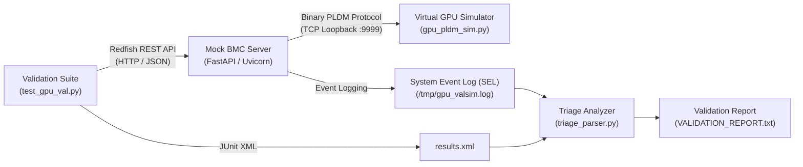

# GPU-ValSim: Enterprise GPU DMTF PLDM & Redfish Automated Validation Simulator

[](https://pytest.org)
[](https://www.dmtf.org/standards/redfish)
[](https://www.python.org/)

**GPU-ValSim** is an enterprise-grade hardware validation simulator that models an **AMD GPU**, a **BMC (Baseboard Management Controller)**, and an end-to-end telemetry and control plane. It validates hardware state transitions, thermal monitoring, power capping, boundary protection, and event log auditing across standard industry specifications (**DMTF PLDM DSP0240 / DSP0248** and **DMTF Redfish**).

---

## Architecture Overview



### Components

1. **Virtual GPU Simulator (`gpu_pldm_sim.py`)**:
   - Implements DMTF DSP0240 (Base PLDM) & DSP0248 (Platform Monitoring & Control).
   - Simulates GPU telemetry registers: Core Temperature (`SENSOR_ID_TEMPERATURE`), Power Draw (`SENSOR_ID_POWER`), and Power Cap Effecter (`EFFECTER_ID_POWER_CAP`).
   - Listens on TCP socket `:9999` to emulate out-of-band hardware buses (e.g., I2C/SMBus, MCTP over PCIe).
   - Dynamically throttles simulated power when requested caps are enforced.
   - Supports fault injection via `INJECT_THERMAL_SPIKE=1`.

2. **Mock BMC Redfish Server (`bmc_redfish_server.py`)**:
   - Exposes DMTF Redfish RESTful APIs using FastAPI:
     - `GET /redfish/v1/Chassis/GPU_0/Thermal` - Queries GPU temperature and reports health state (`OK` / `Critical`).
     - `PATCH /redfish/v1/Chassis/GPU_0/Power` - Enforces power limits (100W–500W safe operating range) and translates payloads into binary PLDM commands.
     - `GET /redfish/v1/Systems/1/LogServices/EventLog/Entries` - Serves System Event Log (SEL) records.
   - Logs security, threshold, and communication events with high-precision ISO timestamps to `/tmp/gpu_valsim.log`.

3. **Automated Validation Suite (`test_gpu_val.py`)**:
   - `TC_01_TELEMETRY_READ`: Validates thermal schema conformity and operational nominal bounds (20°C–85°C).
   - `TC_02_POWER_CAP_ENFORCE`: Validates functional power capping (e.g., 250W) and confirms state change application.
   - `TC_03_INVALID_POWER_CAP`: Parametrized negative testing (-50W, 0W, 9999W) to ensure defensive validation and HTTP 400 rejection without crashing the BMC.
   - `TC_04_EVENT_LOG_AUDIT`: Validates that telemetry actions and security rejections are logged into the SEL.

4. **Automated Triage Parser (`triage_parser.py`)**:
   - Ingests test outputs (`results.xml`) and BMC event logs.
   - Generates an executive Markdown validation and triage summary report (`VALIDATION_REPORT.txt`).

5. **Test Harness (`run_validation.sh`)**:
   - Automates pipeline execution: launches virtual GPU and BMC daemons, verifies process readiness, executes Pytest with JUnit XML output, and safely tears down daemons on exit.

---

## Quickstart

### Prerequisites

- Python 3.10 or newer
- Virtual environment (`venv`)

### 1. Installation

```bash
git clone https://github.com/Mercer002/GPU-valsim.git
cd GPU-valsim
python3 -m venv venv
source venv/bin/activate
pip install -r requirements.txt
```

### 2. Run the Validation Pipeline

Execute the end-to-end automated test harness:

```bash
chmod +x run_validation.sh
./run_validation.sh
```

### 3. Generate Triage Report

Run the triage analyzer to produce an executive status report:

```bash
python3 triage_parser.py
```

Inspect the generated `VALIDATION_REPORT.txt` for pass rates, event audit logs, and hardware engineering assessments.

---

## API & Protocol Reference

### PLDM Packet Formats (DSP0248)

| Field | Length | Description |
| :--- | :--- | :--- |
| Header Byte 0 | 1 Byte | Request (0x01) or Response (0x80 \| Instance ID) |
| PLDM Type | 1 Byte | `0x02` (Platform Monitoring & Control) |
| Command Code | 1 Byte | `0x11` (GetSensorReading), `0x39` (SetNumericEffecterValue) |
| Completion Code | 1 Byte | `0x00` (Success), `0x02` (Invalid Data) |
| Payload | Variable | Sensor ID, Effecter ID, 16-bit Telemetry values |

### Redfish Endpoints

| Method | Endpoint | Description |
| :--- | :--- | :--- |
| `GET` | `/redfish/v1/Chassis/GPU_0/Thermal` | Fetch GPU core temperature and health status |
| `PATCH` | `/redfish/v1/Chassis/GPU_0/Power` | Set GPU power limit (`LimitInWatts`) |
| `GET` | `/redfish/v1/Systems/1/LogServices/EventLog/Entries` | Retrieve BMC System Event Log (SEL) |

---

## License

This project is licensed under the MIT License - see the LICENSE file for details.
